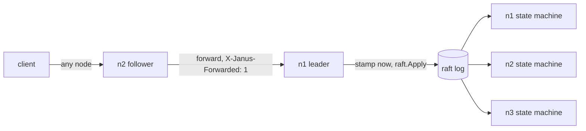

# janus

a small raft-replicated lock service in go. clients hold leases, take try-acquire locks owned by those leases, and get fencing tokens that let the protected resource reject a holder that lost its lock without knowing it.

janus is built on [hashicorp/raft](https://github.com/hashicorp/raft) for consensus and [raft-boltdb](https://github.com/hashicorp/raft-boltdb) for storage. its own code is the state machine, time handling, routing to the leader, and the tests that check them under failure.

```sh
docker compose up --build        # 3-node cluster, http on localhost:8081 to 8083
go test -race ./...              # every test, including the chaos test
go run ./bench                   # the numbers quoted below
```

## what it guarantees

each guarantee names the committed test that checks it.

| guarantee | checked by |
|---|---|
| at any log index, a lock maps to at most one lease | `TestAcquireOfLockHeldByLiveLeaseIsRefused`, and the chaos test's grant history |
| every new grant gets a larger token than every earlier grant | `TestAcquireFreeLockUsesEntryIndexAsToken`, chaos test |
| a lease past its deadline never comes back | `TestRenewOfExpiredLeaseIsRefused`, `TestPromoteDropsLeaseAlreadyDeadAtLastAppliedTime` |
| a lease's locks die with it, in the same entry | `TestExpireReleasesAllLocksOfTheLeaseOnly` |
| replicas that apply the same log hold byte-identical state | `TestChaosReplicasConvergeAndTokensStayFenced` |
| every endpoint is safe to retry, lease creation included | `TestCreateRepeatReturnsExistingLeaseWithoutMovingDeadline`, `TestReentrantAcquireReturnsExistingToken` |

the chaos test runs concurrent clients against an in-process 3-node cluster while it kills leaders, partitions nodes and gives every node a different clock. at the end it checks that every node's encoded state is byte-identical, that no token went to two grants, and that a grant which finished before another started on the same lock has the smaller token. it runs in ci on every push, with the race detector. its seed is logged, and `JANUS_CHAOS_SEED` replays the fault schedule.

### what a lease does not guarantee

a lease alone cannot give mutual exclusion in the real world. a client can pause for longer than its ttl, in a gc pause or a vm stall. janus expires the lease and grants the lock to someone else, and the paused client wakes up still believing it holds the lock. only a fencing check at the resource catches this.

janus guarantees the token order. the resource has to check it. store the largest token seen and reject anything smaller:

```sql
update jobs
set last_run = now(), last_token = $1
where name = $2 and last_token < $1;
-- zero rows updated means the token was stale
```

## how it works



the life of an acquire:

1. `PUT /v1/locks/build-cache` arrives at n2.
2. n2 is a follower, so it forwards the request to n1 with `X-Janus-Forwarded: 1`.
3. n1 validates the name and body, stamps its clock into the command and calls `raft.Apply`.
4. hashicorp/raft replicates the entry. once a majority has it on disk, it commits, say at index 4812.
5. every node applies it to its own state machine. on n1, apply returns token 4812, and the answer goes back through n2.

### the state machine is a pure function of the log

`internal/lock` holds the state and one function, `Apply(index, command)`. it reads no clock, no random source and no network. the leader stamps `now` into each command before proposing it, and clients choose lease ids, so every replica and every replay computes the same state. v1 of janus read `time.Now()` inside apply, so replicas computed different deadlines.

- time inside the state machine is `max(state.Now, cmd.now)`, so it never moves backwards when a new leader's clock is behind the old one.
- a lease is live while `now < expiresAt`.
- any command that finds a lease past its deadline evicts it and its locks in the same entry. an expired holder never blocks an acquire.
- each lease keeps the set of lock names it holds, so expiring a lease touches only its own locks.

### fencing tokens are raft indexes

the token is the index of the log entry that granted the lock. the cluster already agrees on it, it only grows, it is unique per entry and it survives snapshots. a separate counter would be one more field to replicate and get wrong. tokens are not consecutive per lock. clients only compare them.

release takes the lease id and the token. a lease can acquire, release and acquire the same lock again, and a late retry of the first release must not drop the second grant.

### a new leader serves nothing until it is ready

hashicorp/raft reports a node as leader before its state machine has applied the previous term's entries. so leadership alone does not open the node to traffic:

1. on gaining leadership in term t, every read and write gets `503 no_leader`.
2. `Barrier()`, so every entry from earlier terms is applied.
3. propose `promote`. it drops leases already dead at the last applied time, then gives every surviving lease a fresh deadline, because no client could renew during the election.
4. mark the node ready for term t and start the expiry sweep.

readiness is scoped to the raft term, so a slow goroutine from an old term can never open the gate for a later one.

### reads

`GET /v1/locks/{name}` is forwarded to the leader like a write. the leader checks readiness, then calls `VerifyLeader()` to confirm no newer leader exists, then reads local state. that costs one heartbeat round instead of an fsynced log entry. a lock whose holder is past its deadline reads as `held: false`.

### expiry

the leader scans for expired leases every 500 ms and proposes one batched `expire` command for up to 1,000 of them. the state machine rechecks each deadline, so a lease renewed between the scan and the apply survives. with eviction on touch, the sweep is garbage collection. it frees memory and capacity, but no acquire ever waits for it.

### layout

dependencies point one way: `api -> node -> lock`. the clock, network and disk stay at the edges, so `lock` is tested as pure code.

| package | owns |
|---|---|
| `internal/lock` | state, commands, apply, eviction, snapshot and restore, every invariant |
| `internal/node` | raft setup, stamping time, the readiness gate, forwarding, verified reads, the sweep |
| `internal/api` | routes, json, input validation, error codes, request ids |
| `internal/config` | env parsing, fails fast on anything missing or malformed |
| `cmd/janus` | wiring and graceful shutdown |
| `client` | a thin go client, used by the bench and the chaos test |
| `bench` | `go run ./bench` |

## http api

seven json endpoints. any node accepts any request. bodies are capped at 4 KiB.

| method and path | body | success | errors |
|---|---|---|---|
| `POST /v1/leases` | `{"lease_id": "9f2c…", "ttl_ms": 15000}` | `201`, or `200` when that lease already exists | `400 invalid_lease_id`, `400 invalid_ttl`, `409 lease_exists`, `429 capacity_exceeded` |
| `POST /v1/leases/{id}/renew` | none | `200 {"ttl_ms": 15000}` | `404 lease_not_found`, `404 lease_expired` |
| `DELETE /v1/leases/{id}` | none | `204`, also when already gone | none |
| `PUT /v1/locks/{name}` | `{"lease_id": "9f2c…"}` | `200 {"token": 4812}` | `400 invalid_name`, `404 lease_not_found`, `404 lease_expired`, `409 lock_held`, `429 capacity_exceeded` |
| `POST /v1/locks/{name}/release` | `{"lease_id": "9f2c…", "token": 4812}` | `200 {}` | `409 not_held` |
| `GET /v1/locks/{name}` | none | `200 {"name": "…", "held": true, "token": 4812}` | `400 invalid_name` |
| `GET /v1/status` | none | this node's local view | none |

any endpoint except status can also return `503 no_leader` (nothing was written) or `503 outcome_unknown` (the write may or may not have applied). both are safe to retry. errors share one shape:

```json
{"error": {"code": "lock_held", "message": "lock is held by another lease"}}
```

a client's life:

1. generate a lease id with `crypto/rand` (`client.NewLeaseID` does this) and create the lease. a retry with the same id returns the same lease.
2. renew every ttl / 3. a client that misses renewals must stop using its locks once its own deadline passes.
3. acquire a lock and send the token with every write to the protected resource. a retry by the holder returns the same token.
4. release with the lease id and token, or revoke the lease on shutdown. after `outcome_unknown`, a retried release that gets `409 not_held` means the first attempt worked.

## measured numbers

from `go run ./bench`, on one laptop (amd ryzen 7 5800hs, 16 GB, docker desktop on windows with 16 cpus and 7.5 GB for the engine). 3 nodes in docker compose, fsync on, loopback network. these are single-machine numbers, not a claim about production. raft heartbeat timeout 1s, election timeout 1s, leader lease timeout 500ms (hashicorp/raft's defaults).

| measurement | result | setup |
|---|---|---|
| acquire + release throughput | 1636 pairs/s | 64 clients, 30s, spread over 3 nodes |
| acquire latency | p50 19.5 ms, p99 29.1 ms | same run, client-side |
| contended acquire | 57 grants/s, at most 1 holder | 64 clients, one lock, 30s |
| failover window | median 1.39 s, max 2.07 s | 5 leader kills, kill to first successful acquire |
| mass expiry drain | 100000 leases reclaimed 1.01 s after their shared deadline | one deadline for every lease, no client touches them |
| snapshot at the caps | 22.3 MB, encoded in 142.9 ms | 100000 leases, 100000 locks, in-process |
| expiry scan at the caps | 6.6 ms | 100000 leases, 100000 locks, in-process, nothing expired so every lease is checked |

the failover window covers the election, the barrier and promote. contended acquire is low because every refused acquire is still a committed raft entry (see trade-offs).

## run it

a 3-node cluster:

```sh
docker compose up --build
curl localhost:8081/v1/status
```

`docker compose kill janus-1` (or whichever node is leader) and poll `/v1/status` on the other two to watch a new leader take over. `docker compose stop` on two nodes leaves no quorum: writes and lock reads return 503, status still answers.

one node without docker, with the values from `.env.example`:

```sh
JANUS_NODE_ID=n1 JANUS_PEERS=n1=127.0.0.1 JANUS_DATA_DIR=./data go run ./cmd/janus
```

in powershell, set the variables with `$env:JANUS_NODE_ID="n1"` and so on first. config comes from three variables, and a missing or malformed value stops the process with an error naming it:

| variable | example |
|---|---|
| `JANUS_NODE_ID` | `n1` |
| `JANUS_PEERS` | `n1=janus-1,n2=janus-2,n3=janus-3` |
| `JANUS_DATA_DIR` | `/data` |

every node listens on 7000 for raft and 8080 for http. on first start, every node bootstraps with the same peer list, which hashicorp/raft allows. on restart, existing state is found and replayed. on sigterm a node drains http, hands leadership to a peer if it is leader, then stops raft.

## test it

```sh
go test -race ./...     # everything, about 20 s on the laptop above
go test -short ./...    # skips the chaos test
golangci-lint run
go run ./bench          # needs the compose cluster, -nodes to point elsewhere
```

the race detector needs cgo. ci runs it on linux, so a windows machine without a c toolchain can still use `go test ./...`.

| suite | where | what it pins |
|---|---|---|
| 17 state machine tests | `internal/lock` | each rule: eviction, the time clamp, re-entrant acquire, conditional release and expire, promote, caps, snapshot round trip |
| 7 cluster tests | `internal/node` | the gate's term check, forwarding, a dropped forward, failover, the sweep, verified reads |
| 1 chaos test | `internal/node` | convergence, token uniqueness and order under kills, partitions and clock skew |
| 1 config test | `internal/config` | a malformed peer list fails startup |

cluster tests run real raft over in-memory transports and real http over `httptest` servers. the only stubs are the network transport and a per-node fake clock. each test was checked against one realistic mutation of the code it covers, for example a gate that ignores the term or a read that skips `VerifyLeader`.

## trade-offs

| decision | why | rejected alternative |
|---|---|---|
| build on hashicorp/raft | the interesting work is the state machine on top | etcd-io/raft: lower level, janus would also write transport and storage |
| leader stamps time into each command | the state machine must be a pure function of the log | each node reads its own clock in apply: replicas diverge |
| clamp state machine time with max | a new leader with a slower clock must not move time backwards | trust the stamp: a deadline could un-expire |
| client-chosen lease ids | makes create idempotent like every other call | leader-generated ids: a retried create leaks a lease |
| token is the raft index | already agreed, increasing, unique, kept across snapshots | a separate counter: more replicated state, same guarantee |
| renews go through raft | all lease state lives in the log, so failover needs no rebuild | etcd-style deadlines in leader memory: faster renews, rebuilt on promote |
| reset live leases on promote | clients cannot renew during an election | keep old deadlines: leases expire right after every failover |
| term-scoped readiness gate | raft calls a node leader before it has caught up | trust `IsLeader`: stale reads, writes that race promote |
| evict on touch, sweep as gc | an expired holder never blocks an acquire | sweep only: false `lock_held` for up to one interval |
| followers forward to the leader | clients can hit any node or a load balancer | 307 redirect: every client must reach every node |
| `VerifyLeader` before reads | a deposed leader may not know yet | reads through the log: correct, but an fsynced write per read |
| rejected commands still commit | the state machine decides, so the decision replicates | a leader-side pre-check: a read-then-write race, only an optimization |
| json commands and snapshots | readable in logs and tests | protobuf: smaller and faster, adds codegen |

known limits, stated rather than hidden:

- **a forward jump of the leader's clock**, such as an ntp step, expires leases early. fencing tokens still protect the resource.
- **leadership flapping** extends live leases on every promote, so a crashed client's locks come back only once a leader holds for a full ttl. that favors safety over fast reclaim.
- **a client that crashes just before failover** keeps its locks for up to one extra ttl, for the same reason.
- **expired but unswept leases** with other ids count toward the lease cap until the sweep reaches them. the mass expiry number above shows how fast it drains.
- **contended locks are expensive.** every refused acquire is a committed entry. clients should back off on `lock_held`.

## security model

janus trusts its network and treats each lease id as a secret.

- raft and http ports are meant for a private network. anyone who can reach the raft port can send raft rpcs. compose publishes only the http ports.
- a lease id is 128 random bits. holding it is what lets a client renew, acquire with, release with or revoke a lease. reads never return lease ids, and logs never contain them.
- the server checks the id's format but cannot check its randomness. a client that picks a weak id only weakens its own lease.
- fencing tokens are not secrets. release also needs the lease id.
- caps are checked inside the state machine, so they replicate: 100,000 leases, 100,000 locks, 128-character lock names matching `[A-Za-z0-9._/-]+`, ttls from 5 s to 10 min. a flood of creates gets `429`.
- the http server sets read, write and idle timeouts. the image is a static binary on distroless, running as a non-root user.

## deliberately not built

| feature | why not | scaling path |
|---|---|---|
| dynamic membership | a fixed cluster covers every failure mode shown here | `POST /v1/cluster/join` calling `AddVoter` and `RemoveServer` |
| blocking acquire, wait queues, watches | needs long-lived connections and fairness rules | a watch stream per lock, fed from applied commands |
| auth and tls | meant for a private network, lease ids are capabilities | mtls between clients and nodes and between peers |
| leader-only renews | replicating renews keeps all state in the log | deadlines in leader memory, rebuilt on promote |
| follower reads | `VerifyLeader` reads are enough at this scale | read-index reads served by followers |
| metrics endpoint | `/v1/status` and structured logs cover a demo | export hashicorp/raft's go-metrics to prometheus |
| client keepalive helper | the client stays thin | a `KeepAlive(ctx, lease)` goroutine |
| log entry versioning | one version exists | a version byte in front of each command |
| a faster sweep | an o(leases) scan takes 6.6 ms at the cap | a min-heap keyed by deadline |
| more than one raft group | out of scope | shard lock names across groups |

## references

- martin kleppmann, [how to do distributed locking](https://martin.kleppmann.com/2016/02/08/how-to-do-distributed-locking.html), on why leases need fencing tokens.
- mike burrows, [the chubby lock service for loosely-coupled distributed systems](https://research.google/pubs/the-chubby-lock-service-for-loosely-coupled-distributed-systems/), the origin of sequencers and lease-based locks.
- diego ongaro and john ousterhout, [in search of an understandable consensus algorithm](https://raft.github.io/raft.pdf), the raft paper.
